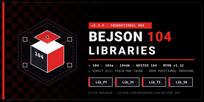

# BEJSON 104 Core & Vertical Domain Library Ecosystem (`libraries_104`)


*_Figure 1: BEJSON 104 Foundational Era Architecture & Multi-Language Ecosystem_*

> **The Official Reference Implementation for BEJSON Foundational Era Formats (`104`, `104a`, `104db`, Nested `104`) and Multi-File Database (`MFDB v1.31` / `v1.32` / `v1.39`) across Python, JavaScript, TypeScript, and Bash.**

---

## Table of Contents
- [Prerequisites & Environment Setup](#prerequisites--environment-setup)
- [Installation & Quick Start](#installation--quick-start)
- [Core Features & Usage Workflows](#core-features--usage-workflows)
- [Multi-Language Quickstart Examples](#multi-language-quickstart-examples)
- [Visual Interface & Architecture Tour](#visual-interface--architecture-tour)
- [System Architecture & Repository Topology](#system-architecture--repository-topology)
- [BEJSON 104 Format Specifications](#bejson-104-format-specifications)
- [Multi-File Database (MFDB) Federation Specification](#multi-file-database-mfdb-federation-specification)
- [O(1) Field-Map Cache & Sanitization Mechanics](#o1-field-map-cache--sanitization-mechanics)
- [CLI Reference & Utilities Matrix](#cli-reference--utilities-matrix)
- [Testing & Quality Verification](#testing--quality-verification)
- [Frequently Asked Questions & Troubleshooting](#frequently-asked-questions--troubleshooting)

---

## Prerequisites & Environment Setup

The BEJSON 104 library ecosystem is zero-dependency by design, executing cleanly on standard Unix, Linux, macOS, and Termux environments.

### System Requirements
- **Python**: Version 3.10 or higher (uses standard library modules: `json`, `os`, `sys`, `pathlib`, `hashlib`, `typing`).
- **Node.js**: Version 18.0.0 or higher with ES2022 module support.
- **TypeScript**: Version 5.0 or higher (for typed projects consuming `Lib_TS`).
- **Bash**: Version 4.4 or 5.x with standard POSIX core utilities (`jq`, `grep`, `sed`, `awk`).

### Environment Variables Setup
To consume libraries portably without hardcoding absolute paths in your application scripts, define the following environment variables in your profile or configuration loader:

```bash
# Path to your local libraries_104 root checkout
export ADMIN_LIBRARIES_104="/path/to/your/libraries_104"

# Add libraries to runtime module resolution paths
export PYTHONPATH="${ADMIN_LIBRARIES_104}/Lib_PY:${PYTHONPATH}"
export NODE_PATH="${ADMIN_LIBRARIES_104}/Lib_JS:${ADMIN_LIBRARIES_104}/Lib_TS:${NODE_PATH}"
export PATH="${ADMIN_LIBRARIES_104}/Lib_SH/Core:${PATH}"
```

---

## Installation & Quick Start

Clone or extract the repository directly into your environment:

```bash
git clone https://github.com/boehnenelton/BEJSON_104.git libraries_104
cd libraries_104
```

Verify the environment across all four language cores:

```bash
# Verify Python Core
python3 Lib_PY/Core/tests/test_mfdb_spec_levels_suite.py

# Verify JavaScript Core
node Lib_JS/Core/tests/test_mfdb_spec_levels_suite.js

# Verify TypeScript Core
npx tsc -p Lib_TS/tsconfig.json --noEmit

# Verify Bash Core
bash Lib_SH/Core/tests/test_mfdb_spec_levels.sh
```

---

## Core Features & Usage Workflows

BEJSON solves data serialization overhead by cleanly separating the schema header (`Fields`) from raw tabular row vectors (`Values`).

1. **Deterministic Data Separation**: Schemas define field metadata once at the head of the file. Rows contain values in strict column order.
2. **O(1) Constant-Time Field Mapping**: Column lookups never use guessed or hardcoded numeric indexes. Runtimes build a cached name-to-index lookup table on load.
3. **Multi-File Database (MFDB) Federation**: Manifest files (`104a.mfdb.bejson`) orchestrate multiple discrete tabular entity files into a unified relational database with Master, Slave, and Standalone roles.
4. **Recursive Cell Nesting (Nested 104)**: Arbitrary BEJSON documents can be nested directly within individual table cells up to 16 levels deep without syntax breaks.
5. **Universal 4-Language Parity**: Identical error codes, validation semantics, and CRUD operations exist across Python (`Lib_PY`), JavaScript (`Lib_JS`), TypeScript (`Lib_TS`), and Bash (`Lib_SH`).

---

## Multi-Language Quickstart Examples

### 1. Python (`Lib_PY/Core`)
```python
from lib_bejson_Core_bejson_core import (
    bejson_core_parse_bejson,
    bejson_core_get_field_map,
    bejson_core_insert_record
)
from lib_bejson_Core_bejson_validators import bejson_validator_validate_document

# Load and validate a 104 document
document = bejson_core_parse_bejson("data/users.bejson")
validation_report = bejson_validator_validate_document(document)
assert validation_report["is_valid"]

# Access row values via O(1) Field-Map Cache
field_map = bejson_core_get_field_map(document)
for row in document["Values"]:
    user_name = row[field_map["name"]]
    user_email = row[field_map["email"]]
    print(f"User: {user_name} <{user_email}>")

# Insert a new record
updated_doc = bejson_core_insert_record(document, ["u_105", "Dev User", "dev@example.org"])
```

### 2. JavaScript (`Lib_JS/Core`)
```javascript
const {
  bejson_core_parse_bejson,
  bejson_core_get_field_map,
  bejson_core_insert_record
} = require("./Lib_JS/Core/lib_bejson_Core_bejson_core");
const {
  bejson_validator_validate_document
} = require("./Lib_JS/Core/lib_bejson_Core_bejson_validators");

const doc = bejson_core_parse_bejson("data/users.bejson");
const report = bejson_validator_validate_document(doc);
if (!report.is_valid) throw new Error("Validation failed");

const fieldMap = bejson_core_get_field_map(doc);
doc.Values.forEach(row => {
  console.log(`User: ${row[fieldMap.name]} <${row[fieldMap.email]}>`);
});
```

### 3. TypeScript (`Lib_TS/Core`)
```typescript
import {
  parseBejson,
  getFieldMap,
  insertRecord
} from "./Lib_TS/Core/lib_bejson_Core_bejson_core";
import { validateDocument } from "./Lib_TS/Core/lib_bejson_Core_bejson_validators";
import { BEJSONDocument } from "./Lib_TS/Core/lib_bejson_Core_bejson_types";

const doc: BEJSONDocument = parseBejson("data/users.bejson");
const report = validateDocument(doc);
if (!report.isValid) throw new Error("Document invalid");

const fieldMap = getFieldMap(doc);
for (const row of doc.Values) {
  console.log(`User: ${row[fieldMap["name"]]}`);
}
```

### 4. Bash (`Lib_SH/Core`)
```bash
source Lib_SH/Core/lib_bejson_Core_bejson_core.sh
source Lib_SH/Core/lib_bejson_Core_bejson_validators.sh

# Validate document
bejson_validator_validate_document "data/users.bejson"
if [ $? -ne 0 ]; then
  echo "Validation failed" && exit 1
fi

# Fetch cell value via field name
USER_NAME=$(bejson_core_get_cell "data/users.bejson" 0 "name")
echo "First user: ${USER_NAME}"
```

---

## Visual Interface & Architecture Tour

The BEJSON 104 ecosystem includes rich visual and terminal UI tooling across domains:

```
[MFDB Master Database Manifest: 104a.mfdb.bejson]
  ├── Network_Role: "Master"
  ├── Registered Entities:
  │     ├── Users (data/users.bejson) ── [Format 104 Table]
  │     ├── Orders (data/orders.bejson) ── [Format 104 Table]
  │     └── Settings (config/app.104a.bejson) ── [Format 104a Config]
  └── Connected Slaves:
        └── Analytics Slave (node_analytics/104a.mfdb.bejson)
```

The modular components allow high-speed rendering in terminal interfaces (`Lib_SH/Terminal_Menus`), canvas workflows (`Lib_PY/Diagrams`), and layout generators (`Lib_PY/BEHTML`).

---

## System Architecture & Repository Topology

`libraries_104` hosts both the Foundational Core engine and all mature domain families:

```
libraries_104/
├── Lib_PY/                    # Python 3.10+ Implementations
│   ├── Core/                  # Base 104/104a/104db parser, validator, chunker
│   ├── AI/                    # Zero-SDK REST prompting & model routing
│   ├── BEHTML/                # Spatial 8-lane / Ry=32px HTML generators
│   ├── CMS/                   # Static site and document compilation engine
│   ├── Diagrams/              # Interactive diagramming and canvas exporters
│   ├── Gaming/                # Grid mechanics, physics, and state engines
│   ├── Lists/                 # Dense list validators and serializers
│   └── Utility/               # Cryptographic hashes, timers, string tools
├── Lib_JS/                    # CommonJS / ES2022 JavaScript Core & Utilities
│   ├── Core/                  # Complete 104/MFDB core engine and validators
│   ├── Diagrams/              # Browser diagram renderers
│   ├── Gaming/                # In-browser game state loop
│   └── HTML/                  # DOM hydration and spatial components
├── Lib_TS/                    # TypeScript 5.x Typed Implementations
│   ├── Core/                  # Strongly typed 104/MFDB engine with full typing
│   ├── Diagrams/              # Typed visual canvas models
│   └── Gaming/                # Strongly typed game and physics loops
├── Lib_SH/                    # POSIX / Bash 5.x Terminal Implementations
│   ├── Core/                  # jq-powered 104/MFDB core engine and validator
│   ├── Animation/             # ANSI terminal animation frames
│   ├── Terminal_Menus/        # 57-column high-density TUI menus
│   └── Schedules/             # Cron and minute-based job daemons
└── images/banners/            # Brand visual assets and documentation banners
```

---

## BEJSON 104 Format Specifications

Every BEJSON 104 file is valid JSON that enforces strict top-level keys and positional row arrays:

### Mandatory Top-Level Keys
1. `"Format"`: Must be `"BEJSON"`.
2. `"Format_Version"`: `"104"` (Standard Table), `"104a"` (Flat Metadata/Config), or `"104db"` (Multi-Table Bundle).
3. `"Format_Creator"`: Maintainer signature (`"Elton Boehnen"`).
4. `"Records_Type"`: Non-empty array of strings naming the records contained.
5. `"Fields"`: Array of objects each specifying `"name"` and `"type"`.
6. `"Values"`: Two-dimensional array of table row values matching `Fields` length and primitive types.

### Example: Format 104 Standard Table
```json
{
  "Format": "BEJSON",
  "Format_Version": "104",
  "Format_Creator": "Elton Boehnen",
  "Records_Type": ["Customer"],
  "Fields": [
    {"name": "customer_id", "type": "string"},
    {"name": "full_name", "type": "string"},
    {"name": "is_active", "type": "boolean"},
    {"name": "account_balance", "type": "float"}
  ],
  "Values": [
    ["cust_1001", "Jane Doe", true, 2450.75],
    ["cust_1002", "John Roe", false, 0.00]
  ]
}
```

---

## Multi-File Database (MFDB) Federation Specification

MFDB v1.31/v1.39 turns multiple BEJSON files into an orchestrated relational database:

1. **The Manifest File (`104a.mfdb.bejson`)**:
   - Declares `"Records_Type": ["mfdb"]`.
   - Contains headers: `MFDB_Version`, `DB_Name`, `Network_Role`.
   - Contains a registry table of entities (`entity_name`, `file_path`, `primary_key`, `record_count`).
2. **Network Role Hierarchy**:
   - `"Master"`: Root authority capable of registering connected slave nodes.
   - `"Slave"`: Subordinate node with zero upward references to master administration.
   - `"Standalone"`: Independent database instance. Invalid role strings emit error code `[30]`.
3. **Bidirectional Parent_Hierarchy Verification**:
   - Every child entity table must contain `"Parent_Hierarchy": ["104a.mfdb.bejson"]` pointing back to its owning manifest.
   - Broken or asymmetric parent paths trigger error code `[36]` or `[38]`.
4. **Tooling Convention on Foreign Keys (`_fk`)**:
   - Column identifiers ending in `_fk` represent relational linkage.
   - In 104, `_fk` naming is strictly optional and advisory; validators emit non-fatal warnings on unresolvable foreign targets without rejecting the database.

---

## O(1) Field-Map Cache & Sanitization Mechanics

### Field-Map Cache
Direct numeric row indexing (`row[0]`, `row[1]`) is strictly avoided across all library logic. Runtimes build a constant-time lookup cache mapping column names to array indexes:

$$\text{field\_map} = \{ \text{field.name} : \text{index} \mid \text{index} \in [0, \text{len}(\text{Fields}) - 1] \}$$

### Boundary Sanitization
Before values are serialized or inserted:
- Leading and trailing whitespace is stripped from string keys and values.
- Empty lines and extraneous carriage returns are sanitized at system boundaries.
- Type integrity is enforced against closed schema primitive sets (`string`, `integer`, `float`, `boolean`, `null`, `any`).

---

## CLI Reference & Utilities Matrix

| Language | Script / Tool | Primary Capabilities |
| :--- | :--- | :--- |
| **Python** | `Lib_PY/Core/cli/bejson_cli.py` | Command-line validation, format inspection, JSON-to-BEJSON converter |
| **Python** | `Lib_PY/Core/cli/bejson_server.py` | Local Flask static and live document preview server |
| **Python** | `Lib_PY/Core/lib_bejson_Core_bejson_chunking.py` | Pack and unpack codebases into `.104a.bejson` text chunks |
| **Bash** | `Lib_SH/Core/lib_bejson_Core_mfdb_validator.sh` | Shell-based automated Level 1, 2, and 3 MFDB integrity checks |
| **Bash** | `Lib_SH/Terminal_Menus/lib_bejson_TerminalMenus_menu.sh` | 57-column ANSI high-density interactive terminal menus |

---

## Testing & Quality Verification

All four language cores feature comprehensive test suites verifying schema constraints, error codes, and edge-case boundaries.

```bash
# Run all Python Core and MFDB tests
python3 Lib_PY/Core/tests/test_bejson_core.py
python3 Lib_PY/Core/tests/test_mfdb_spec_levels_suite.py

# Run all JavaScript Core tests
node Lib_JS/Core/tests/test_mfdb.js
node Lib_JS/Core/tests/test_mfdb_spec_levels_suite.js

# Run all TypeScript Core tests
npx tsc -p Lib_TS/tsconfig.json --noEmit

# Run all Bash Core tests
bash Lib_SH/Core/tests/test_mfdb_spec_levels.sh
```

### Deterministic Exit Codes
- `0`: Validation successful; zero structural or relational defects.
- `1`: Syntax or file read failure.
- `20-29`: BEJSON Core syntax/structure validation failure.
- `30-39`: MFDB manifest or relational hierarchy violation.

---

## Frequently Asked Questions & Troubleshooting

**Q: Can I use `104` and `105` libraries in the same project?**  
A: Yes. `libraries_104` provides stable Foundational Era primitives and mature vertical domains (CMS, Gaming, Diagrams). `libraries_105` provides Integrity Era UUID-tracked formats and mandatory referential integrity.

**Q: Why does my entity fail with error code `[36]`?**  
A: The child entity file is missing its `"Parent_Hierarchy"` header or does not point to the declaring `104a.mfdb.bejson` manifest file.

**Q: Are foreign keys strictly enforced in 104?**  
A: Foreign key suffixes (`_fk`) in 104 are an advisory tooling standardization convention. Real-time referential cascade and restrict enforcement is exclusive to the 105 specification.